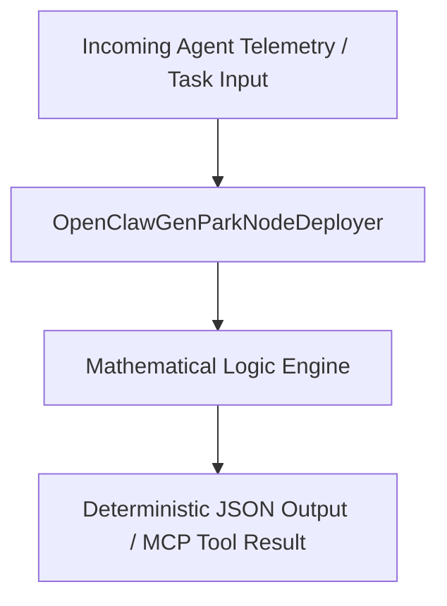

# openclaw-genpark-node-deployer

[](https://github.com/Alpha-Park)
[](https://modelcontextprotocol.io)
[](requirements.txt)
[](#)
[](#)
[](LICENSE)

Production-hardened OpenClaw GenPark Agent skill with a Python standard-library core and an MCP server powered by the official `mcp` SDK. Provides high-throughput deterministic execution, cryptographic security, and game-theoretic optimization via the Model Context Protocol (MCP).

---

## MCP runtime requirements

Use Python 3.10 or newer. The core `client.py` uses only the standard library; `mcp_server.py` requires the official `mcp` SDK (`mcp>=1.0.0,<2`). From this repository's checkout, create an isolated environment and install its requirements:

```bash
python -m venv .venv
.venv/bin/python -m pip install -r requirements.txt
```

On Windows, use `.venv\Scripts\python.exe` instead. You may use an existing Python environment with the requirements installed. Configure your MCP client with that interpreter's absolute path and the absolute path to `mcp_server.py`. The client launches a local STDIO process; the GitHub repository URL is not a remote MCP endpoint.

Example client configuration (replace the placeholder paths):

```json
{
  "mcpServers": {
    "openclaw-genpark-node-deployer": {
      "command": "/absolute/path/to/openclaw-genpark-node-deployer/.venv/bin/python",
      "args": [
        "/absolute/path/to/openclaw-genpark-node-deployer/mcp_server.py"
      ]
    }
  }
}
```

## Architecture & Data Flow



---

## Quickstart & Usage

### 1. Direct Python Client Execution
```bash
python example_usage.py
```

### 2. Standalone MCP Server Launch
Run the local STDIO MCP server using the environment prepared above:
```bash
.venv/bin/python mcp_server.py
```

---

## License

This project is licensed under the MIT License - see the [LICENSE](LICENSE) file for details.
